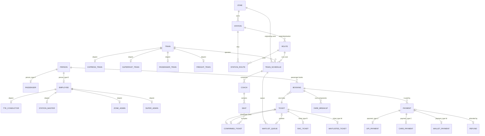

# RailNexus EER Model

Authoritative reference for the specialization/generalization design implemented in
`db/shared_ddl/01_core_schema.sql`. All models use the **table-per-subtype with shared
primary key** pattern: a supertype table stores common attributes plus a discriminator,
and each subtype table reuses the supertype primary key as its own primary and foreign
key, which enforces a 1:1 mandatory relationship.

## Notation

- `{PK}` candidate key, `{FK}` foreign key, `*` mandatory, `o` optional
- **disjoint** means a row may not exist in two sibling subtypes (enforced by trigger)
- **total** means every supertype row must have exactly one subtype row

## Mermaid ER diagram

## Entity dictionary and constraints

### PERSON specialization (disjoint, total)
| Table | Key | Notes |
|---|---|---|
| PERSON | person_id {PK} number | person_type CHAR(1) `CHECK IN ('P','E')`; email, phone unique |
| PASSENGER | person_id {PK,FK} | one document id; total for person_type 'P' |
| EMPLOYEE | person_id {PK,FK} | employee_no unique; total for person_type 'E' |
| TTE_CONDUCTOR | employee_id {PK,FK} | train crew member, one zone |
| STATION_MASTER | employee_id {PK,FK} | responsible for one station |
| ZONE_ADMIN | employee_id {PK,FK} | administrative owner of one zone |
| SUPER_ADMIN | employee_id {PK,FK} | cross-zone operator (least-privilege super admin role) |

Disjointness: a trigger on each subtype rejects a row if the person_type discriminator
does not match, or if a matching row already exists in a sibling subtype table. This is
the correct enforcement point because it applies even when subtype rows are inserted
before the supertype row exists (row-level check deferred to the subtype table rather
than a brittle denormalized column).

### TRAIN specialization (disjoint, total over the four reader-visible subtypes)
| Table | Key | Notes |
|---|---|---|
| TRAIN | train_id {PK} | discriminator train_type CHAR(1) `CHECK IN ('E','S','P','F')`; train_no unique |
| EXPRESS_TRAIN | train_id {PK,FK} | pantry_service optional |
| SUPERFAST_TRAIN | train_id {PK,FK} | superfast_surcharge |
| PASSENGER_TRAIN | train_id {PK,FK} | local/intercity, stops_count |
| FREIGHT_TRAIN | train_id {PK,FK} | cargo_type, max_load_tonnes; never offered for passenger booking |

Constraints: PASSENGER and FREIGHT are disjoint and a train can be only one subtype.
FREIGHT trains have no COACH/SEAT rows in the booking path.

### TICKET specialization (overlapping in life-cycle, modeled as state machine)
| Table | Key | Notes |
|---|---|---|
| TICKET | ticket_id {PK} | pnr CHAR(10) unique with format check, ticket_type CHAR(1) |
| CONFIRMED_TICKET | ticket_id {PK,FK} | status CFM; seat + berth assignment |
| RAC_TICKET | ticket_id {PK,FK} | shares seat, has auth position |
| WAITLISTED_TICKET | ticket_id {PK,FK} | integer position, no seat |

Each BOOKING owns exactly one TICKET (1:1). The subtype is chosen at booking time and
may transition as inventory frees (RAC promoted to CONFIRMED etc.), implemented in
`booking_pkg` (Phase 3).

### PAYMENT specialization (disjoint)
PAYMENT holds amount, masked/tokenized reference and status (PND/CAP/REF/FAL).
UPI/CARD/WALLET subtypes add the provider-specific fields. Full card numbers are never
stored; only masked digits.

### Aggregation
| Entity | Purpose |
|---|---|
| ZONE | head-of-network unit (North, West, South) |
| STATION | station belongs to exactly one zone |
| ROUTE | origin/destination pair with stops given by the STATION_ROUTE association |
| TRAIN_SCHEDULE | train + route + journey_date; the hottest query key is (train_id, journey_date) |
| COACH / SEAT | coaches compose schedules; seats belong to coaches and are reserved per date and per occupied station segment |
| BOOKING | booking header (1:1 ticket, 1:N payments, 1:N fare breakups) |
| WAITLIST_QUEUE | ordering of RAC/waitlist positions per schedule |
| FARE_RULE | per-class tariff with JSON rule document (Phase 5) |
| REFUND | money movement reverse of a payment |

## Cardinality and participation summary

- PERSON : PASSENGER / EMPLOYEE   1:1, total, disjoint
- EMPLOYEE : three role subtypes 1:1, disjoint (roles are mutually exclusive)
- TRAIN : four subtypes           1:1, total, disjoint
- TRAIN_SCHEDULE : ZONE            N:1 (a schedule originates in one zone)
- STATION_ROUTE : STATION          N:1; STATION_ROUTE : ROUTE N:1
- BOOKING : TICKET                1:1, total (every booking creates exactly one ticket)
- TICKET : CONFIRMED/RAC/WL       1:1 alternating over time (state machine)
- BOOKING : PAYMENT                1:N (multiple payment attempts allowed)
- PAYMENT : REFUND                1:0..1
- BOOKING : FARE_BREAKUP           1:N

## Justification notes

See `docs/schema-notes.md` for a comparison against single-table inheritance and why the
subtype tables are indexed with their supertype FK as PK (no join needed when the clause
targets a specific subtype, and NULL-heavy base columns are avoided).